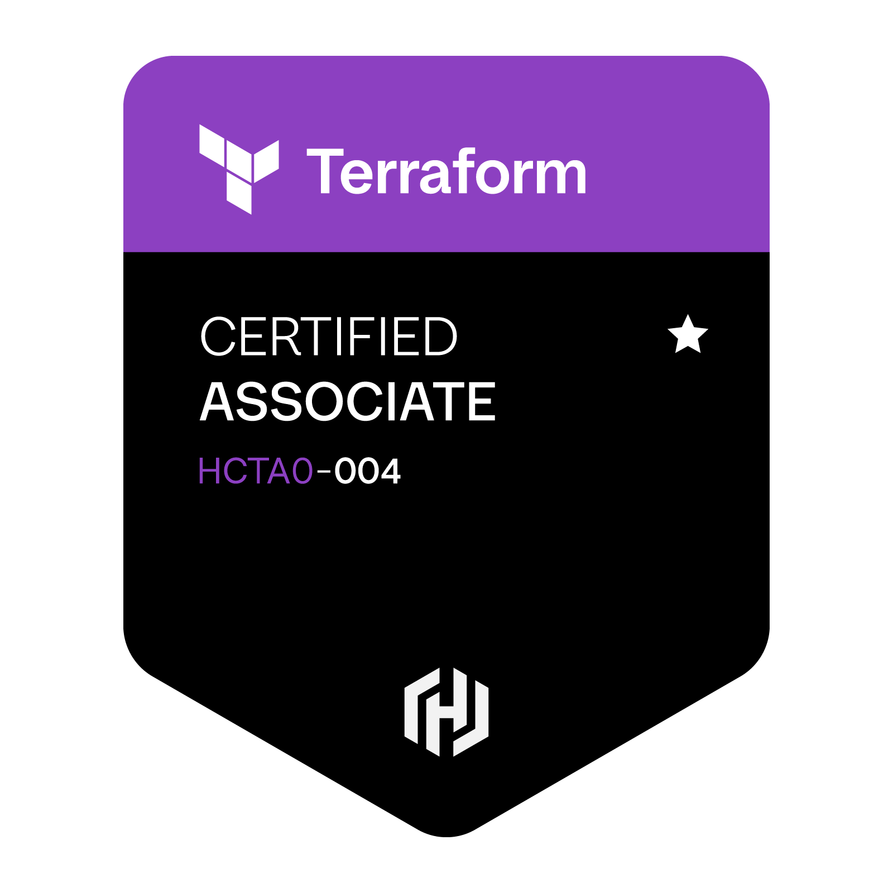

  <a href="./README.md"><strong>English</strong></a>
  &nbsp;|&nbsp;
  <a href="./README-ar.md"><strong>العربية</strong></a>

  

<h1 align="center">منصور الحربي</h1>

  <strong>البنية التحتية السحابية&nbsp; | &nbsp;هندسة الشبكات&nbsp; | &nbsp;أتمتة البنية التحتية</strong>

  أنا منصور، خريج تقنية معلومات من جامعة القصيم، واهتمامي بالبنية التحتية السحابية، وتشغيل الشبكات، وأتمتة الأنظمة. أطبّق اللي أتعلمه من خلال مشاريع عملية باستخدام AWS وTerraform وLinux وCisco، وأحرص إن شغلي يكون آمن، مرتب، موثق، وقابل للاختبار.

  
  
  

  
  
  
  

---

## نبذة عني

حاصل على ثلاث شهادات احترافية: **CCNA**، و**AWS Certified Solutions Architect – Associate**، و**HashiCorp Certified: Terraform Associate (004)**.

ما أكتفي بالمعرفة النظرية؛ أحرص على تطبيق اللي أتعلمه في مشاريع تقنية موثقة، تشمل أتمتة الشبكات، وتحليل سجلات البنية التحتية، وتنفيذ الاختبارات الآلية والتحقق من النتائج.

أطمح أبدأ مسيرتي المهنية ضمن فريق هندسي متخصص في **Cloud Operations** أو **IT Infrastructure** أو **Network Operations**، أتعلم من خبراته وأساهم معه في تشغيل الأنظمة وتطويرها.

متاح للفرص الوظيفية في مختلف مناطق المملكة، ومستعد للانتقال حسب متطلبات العمل، سواء كان حضوريًا أو هجينًا أو عن بُعد.

---

<h2 dir="rtl">الأدوات والتقنيات اللي أشتغل عليها</h2>

  <strong>Cloud Infrastructure & Infrastructure as Code</strong>
    
  
  
  
  

  <strong>Networking & Automation</strong>
    
  
  
  
  
  

  <strong>CI/CD, Testing & Monitoring</strong>
    
  
  
  
  
  

---

## أبرز مشاريعي التقنية

### [مشروع أتمتة شبكات Cisco IOS](https://github.com/MansourMutlaq/Cisco-Network-Automation)

  
  
  

هذا المشروع بنيته لأتمتة مهام شبكات Cisco IOS باستخدام Python، وطبّقته داخل مختبر EVE-NG يضم ستة أجهزة.

المشروع يقرأ بيانات الأجهزة من ملفات YAML، ويحمّل بيانات الدخول بشكل آمن وقت التشغيل، ويتحقق من اتصال SSH باستخدام Netmiko. كذلك ينفذ نسخًا احتياطية مؤرخة لإعدادات الأجهزة، ويجهز قوالب التهيئة باستخدام Jinja2، مع خطوات منظمة لتنفيذ التغييرات والتراجع عنها، وتسجيل العمليات وإصدار التقارير.

**النتائج اللي تحققت منها**

- نجح اتصال SSH على **6/6 أجهزة Cisco IOS**.
- اكتملت النسخ الاحتياطية لإعدادات Running Configuration على **6/6 أجهزة**.
- اجتازت الاختبارات الآلية جميع الحالات بنتيجة **30/30 اختبارًا باستخدام pytest**.

**التقنيات:** Python · Netmiko · YAML · Jinja2 · pytest · Cisco IOS · EVE-NG

[استعرض المشروع ونتائج الاختبارات ←](https://github.com/MansourMutlaq/Cisco-Network-Automation)

---

### [مشروع تحليل ومراقبة أمن البنية التحتية](https://github.com/MansourMutlaq/infrastructure-security-analytics)

  
  
  
  

هذا المشروع يجمع أحداث AWS CloudTrail، وسجلات تسجيل الدخول في Linux، وسجلات أجهزة Cisco IOS داخل مسار تحليل موحّد.

يوحّد البيانات وفق نموذج مستوحى من Elastic Common Schema (ECS)، وبعدها يطبق قواعد الكشف (Detection Rules)، ويحسب مستوى الخطورة، ويربط الأحداث المرتبطة ببعضها، ويصدر تقارير بصيغ HTML وJSON وCSV، مع إمكانية فهرسة النتائج في OpenSearch.

**النتائج اللي تحققت منها**

- اجتازت الاختبارات الآلية جميع الحالات بنتيجة **47/47**، مع تغطية برمجية بلغت **92.98%**.
- اختبرت تكامل CI مع إصدارات **Python 3.12 و3.13 و3.14** باستخدام GitHub Actions.
- اجتاز الكود فحوص Ruff لجودة الكود وBandit للفحص الأمني.
- فهرست **15 حدثًا موحدًا و10 تنبيهات مترابطة** داخل بيئة OpenSearch، وتحققت من النتائج عمليًا.

**التقنيات:** Python · AWS CloudTrail · Linux authentication logs · Cisco IOS · OpenSearch · Docker Compose · GitHub Actions · pytest · Ruff · Bandit · Jinja2

[استعرض المشروع ونتائج الاختبارات ←](https://github.com/MansourMutlaq/infrastructure-security-analytics)

---

### [الكرسي المتحرك الذكي بتقنية IoT والطاقة الشمسية](https://github.com/MansourMutlaq/IoT-Smart-Wheelchair)

  
  
  

هذا مشروع تخرجي من جامعة القصيم، وفكرته كرسي متحرك ذكي يعتمد على ESP32 وتقنيات إنترنت الأشياء (IoT).

يجمع المشروع بين اكتشاف العوائق، ومتابعة بعض المؤشرات الصحية، وتحديد الموقع باستخدام GPS، والاستفادة من الطاقة الشمسية. والهدف منه تحسين أمان المستخدم ومساعدته على التنقل.

**وش كان دوري بالمشروع؟**

- قدت تصميم المشروع والتنسيق التقني وتوزيع المهام بين أعضاء الفريق.
- شاركت في ربط ESP32 واتصال IoT والمستشعرات المرتبطة بوظائف الأمان.
- نفذت منطقًا يعتمد على أكثر من مستشعر لاكتشاف العوائق وإطلاق التنبيهات.
- وثقت تصميم النظام، وربط مكونات الهاردوير، وطريقة تشغيله.

**التقنيات:** ESP32 · C/C++ · IoT sensors · GPS · Embedded systems · Solar energy

[استعرض المشروع والتوثيق ←](https://github.com/MansourMutlaq/IoT-Smart-Wheelchair)

---

<h2 dir="rtl">شهاداتي المهنية</h2>

<table width="100%">
  <tr>
    <td width="33%" align="center" valign="top">
      
        
      <strong>AWS Certified Solutions Architect – Associate</strong>
        
      <a href="https://www.credly.com/badges/dc16e4e2-440d-4ae5-a1af-97329eef6867/public_url">التحقق من الشهادة</a>
    </td>

   <td width="33%" align="center" valign="top">
      
        
      <strong>HashiCorp Certified: Terraform Associate (004)</strong>
        
      <a href="https://www.credly.com/badges/a8118dc7-ab46-4948-a71a-5cc8d87c5d73/public_url">التحقق من الشهادة</a>
    </td>

  <td width="33%" align="center" valign="top">
      
        
      <strong>Cisco Certified Network Associate (CCNA)</strong>
        
      <a href="https://www.credly.com/badges/926aefcd-e73c-46cc-99fd-5a865908ab21/public_url">التحقق من الشهادة</a>
    </td>
  </tr>
</table>

---

<h2 dir="rtl">تواصل معي</h2>

  
  
  

  
  
    
  البريد: <a href="mailto:mansour-alharbi@outlook.com">mansour-alharbi@outlook.com</a>

  جميع النتائج المذكورة مدعومة بالتوثيق وأدلة الاختبارات الموجودة في مستودعات المشاريع.

