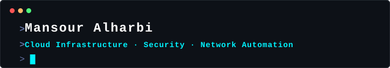
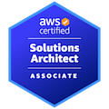
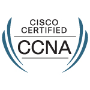

  <a href="./README.md"><strong>English</strong></a>
  &nbsp;|&nbsp;
  <a href="./README-ar.md"><strong>العربية</strong></a>

  

<h1 align="center">Mansour Alharbi</h1>

  <strong>Cloud Infrastructure&nbsp; | &nbsp;Network Engineering&nbsp; | &nbsp;Infrastructure Automation</strong>

  Saudi Information Technology graduate building secure, automated, and well-documented infrastructure across cloud, Linux, and Cisco environments.

  
  
  

  
  
  
  

---

## Engineering Profile

I hold the **AWS Certified Solutions Architect – Associate**, **HashiCorp Certified: Terraform Associate (004)**, and **Cisco Certified Network Associate (CCNA)** certifications. I use documented projects to turn infrastructure concepts into reproducible engineering work with clear architecture, secure configuration, automated validation, and operational evidence.

My current focus is entry-level **Cloud Infrastructure**, **Network Engineering**, **Infrastructure Automation**, and **IT Operations** roles in Saudi Arabia.

---

## Technology Stack

  <strong>Cloud & Infrastructure as Code</strong>
    
  
  
  
  

  <strong>Networking & Automation</strong>
    
  
  
  
  
  

  <strong>Delivery, Testing & Observability</strong>
    
  
  
  
  
  

---

## Featured Engineering Projects

### [Cisco IOS Network Automation Toolkit](https://github.com/MansourMutlaq/Cisco-Network-Automation)

  
  
  

A modular Python network automation toolkit built and validated in a six-device Cisco IOS lab running on EVE-NG. It provides YAML-based inventory, secure runtime credential loading, Netmiko SSH validation, timestamped configuration backups, Jinja2 rendering, controlled deployment and rollback workflows, structured logging, and operational reporting.

**Engineering evidence**

- Validated SSH connectivity across **6/6 Cisco IOS devices**
- Backed up running configurations successfully across **6/6 devices**
- Completed the automated test suite with **30/30 pytest tests passing**

**Stack:** Python · Netmiko · YAML · Jinja2 · pytest · Cisco IOS · EVE-NG

[View source code and validation evidence →](https://github.com/MansourMutlaq/Cisco-Network-Automation)

---

### [Infrastructure Security Analytics](https://github.com/MansourMutlaq/infrastructure-security-analytics)

  
  
  
  

A multi-source analytics pipeline for AWS CloudTrail events, Linux authentication logs, and Cisco IOS telemetry. It normalizes heterogeneous events into an Elastic Common Schema (ECS)-inspired model, applies deterministic detection rules and risk scoring, correlates related activity, and generates investigation-ready HTML, JSON, CSV, and OpenSearch outputs.

**Engineering evidence**

- Completed the automated suite with **47/47 tests passing** and **92.98% statement coverage**
- Validated CI across **Python 3.12, 3.13, and 3.14** using GitHub Actions
- Passed Ruff static analysis and Bandit security scanning
- Indexed **15 normalized events and 10 correlated alerts** in a live OpenSearch validation environment

**Stack:** Python · AWS CloudTrail · Linux authentication logs · Cisco IOS · OpenSearch · Docker Compose · GitHub Actions · pytest · Ruff · Bandit · Jinja2

[View source code and validation evidence →](https://github.com/MansourMutlaq/infrastructure-security-analytics)

---

### [IoT-Enabled Solar-Powered Smart Wheelchair](https://github.com/MansourMutlaq/IoT-Smart-Wheelchair)

  
  
  

An Information Technology capstone project combining ESP32-based control, IoT connectivity, obstacle detection, health monitoring, GPS-based location support, and solar-assisted power to improve user safety and mobility.

**Key contributions**

- Led project architecture, technical coordination, and team delivery
- Integrated embedded control, IoT communication, and sensor-driven safety functions
- Implemented multi-sensor obstacle detection and alerting logic
- Documented system architecture, hardware integration, and operational behavior

**Stack:** ESP32 · C/C++ · IoT sensors · GPS · Embedded systems · Solar energy

[View project documentation and source code →](https://github.com/MansourMutlaq/IoT-Smart-Wheelchair)

---

## Professional Certifications

<table width="100%">
  <tr>
    <td width="33%" align="center" valign="top">
      
        
      <strong>AWS Certified Solutions Architect – Associate</strong>
        
      <a href="https://www.credly.com/badges/dc16e4e2-440d-4ae5-a1af-97329eef6867/public_url">Verify credential</a>
    </td>
    <td width="33%" align="center" valign="top">
      <!-- Add the Terraform credential URL to this image and a verification link when available. -->
      
        
      <strong>HashiCorp Certified: Terraform Associate (004)</strong>
    </td>
    <td width="33%" align="center" valign="top">
      
        
      <strong>Cisco Certified Network Associate (CCNA)</strong>
        
      <a href="https://www.credly.com/badges/926aefcd-e73c-46cc-99fd-5a865908ab21/public_url">Verify credential</a>
    </td>
  </tr>
</table>

---

## Contact

  
  

  
  
    
  Direct email: <a href="https://outlook.live.com/mail/0/deeplink/compose?to=mansour-alharbi@outlook.com">mansour-alharbi@outlook.com</a>

  All reported results are supported by documentation and validation evidence in the corresponding repositories.

